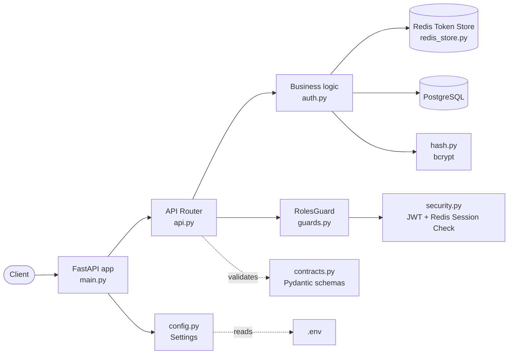
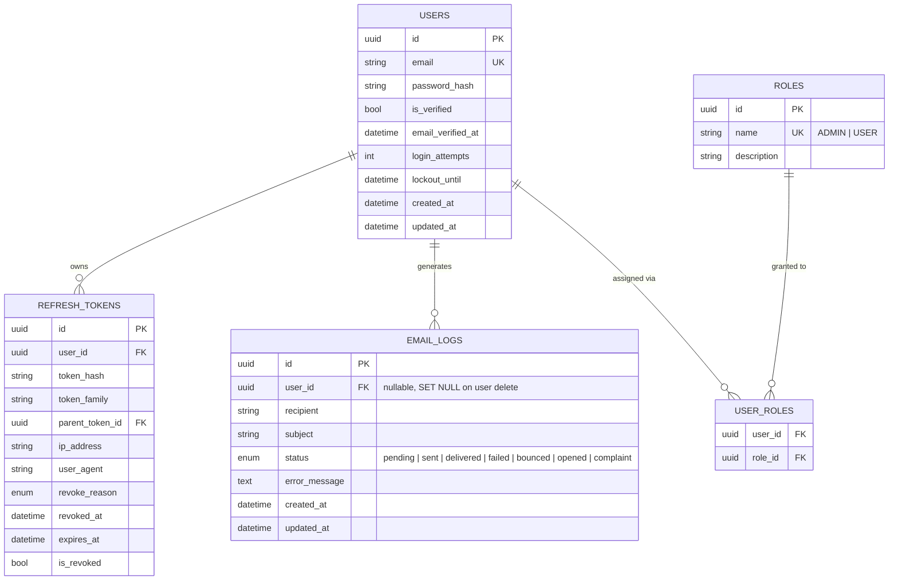
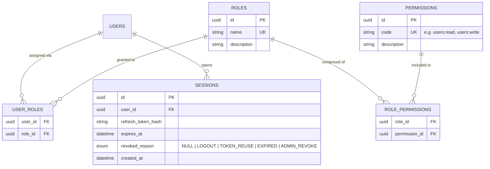
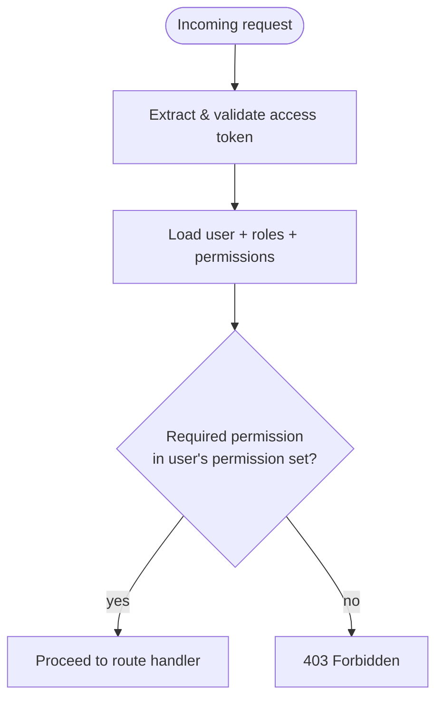
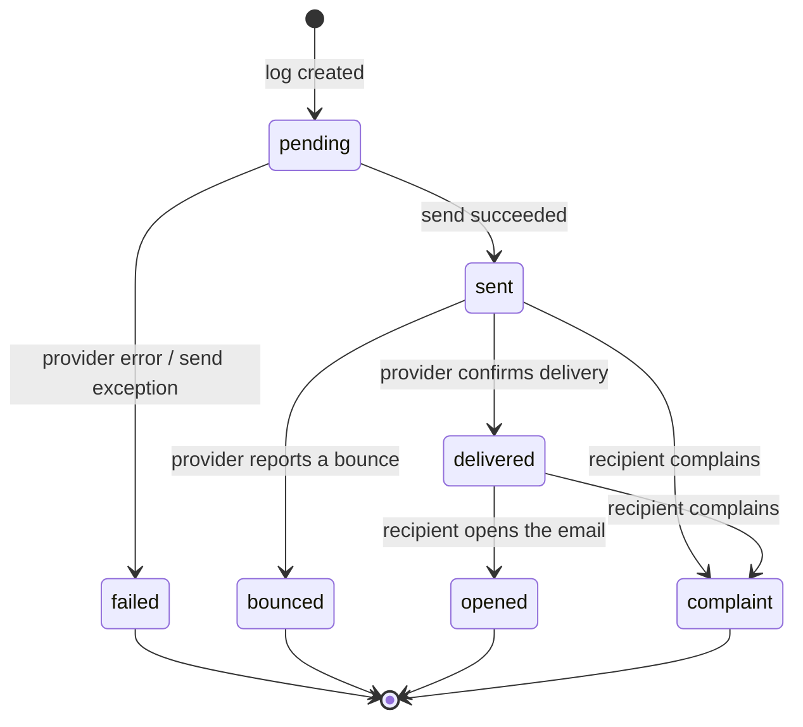
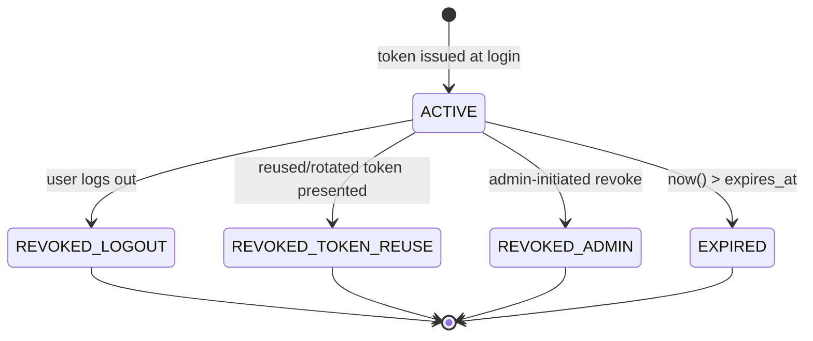

# Template: RBAC + Multitenancy Auth

**Status:** 🟡 In Progress · **Last updated:** 2026-11-01 · **Owners:** see [Iteration Log](#iteration-log)

A general-purpose, tenant-ready authentication and authorization backend built with **FastAPI**, **SQLAlchemy (async)**, and **Alembic**. Designed to be forked/tailored per project: swap the domain models, keep the auth + RBAC skeleton.

> This README documents two things side by side — what is **implemented today** (source of truth, verified against code) and what is **planned** per the current sprint outline (target design, not yet built). Each section is labeled so contributors don't confuse the two.

---

## Table of Contents

1. [Architecture Overview](#1-architecture-overview)
2. [Project Structure](#2-project-structure)
3. [Data Model](#3-data-model)
4. [Security & RBAC](#4-security--rbac)
5. [Email Log State Machine](#5-email-log-state-machine)
6. [Refresh Token Lifecycle](#6-refresh-token-lifecycle)
7. [Database Migrations (Alembic)](#7-database-migrations-alembic)
8. [Configuration & Environment](#8-configuration--environment)
9. [Toolchain](#9-toolchain)
10. [Onboarding: Where Do I Add Things?](#10-onboarding-where-do-i-add-things)
11. [Roadmap](#11-roadmap)
12. [Iteration Log](#iteration-log)

---

## 1. Architecture Overview

### Stack

| Layer | Technology |
|---|---|
| Web framework | FastAPI |
| Session & Token Store | Redis (`redis-py` / `fakeredis`) |
| ORM | SQLAlchemy 2.0 (async) |
| DB driver | `asyncpg` (PostgreSQL) |
| Migrations | Alembic |
| Password hashing | `bcrypt` |
| Config | `pydantic-settings` |
| API docs | Scalar (`/docs`) |
| Linting/formatting | `ruff` (+ `pre-commit`) |
| Dependency management | `uv` |

### Request flow



**Current implementation status:** endpoints implemented:

| Endpoint | Access | Purpose |
|---|---|---|
| `POST /users` | `ADMIN` | Create a user. The new user gets the `USER` role and a verification email. The response lists the user's `roles`. |
| `POST /auth/login` | Public | Verify credentials and return an access and refresh token pair. |
| `POST /auth/refresh` | Refresh token | Rotate the refresh token and issue a new pair. |
| `POST /auth/logout` | Refresh token (access token optional) | End one session. Also revokes the access token if one is sent. |
| `POST /auth/logout-all` | Any authenticated user | End every session of the caller. |
| `GET` / `POST /auth/verify` | Verification token | Mark an email address as verified. |
| `POST /bootstrap` | Bootstrap token | Create the first admin. Only exists when `BOOTSTRAP_MODE=http`, and is hidden from the API docs. |
| `GET /admin/dashboard` | `ADMIN` | Example of the `@Roles` + `RolesGuard` pattern. |

All paths are mounted under `settings.API_V1_STR` (default `/api/v1`).

### Security layer (as implemented today)

- Passwords are hashed with `bcrypt` (`hash.py`) — never stored or compared in plaintext.
- Roles are rows in the `roles` table, linked to users through `user_roles`, so a user can hold several. Access tokens carry the role names, and `@Roles(...)` plus `RolesGuard` allow a request when any of the user's roles matches.
- Refresh tokens, session metadata, token rotation reuse flags, and access token revocation timestamps are managed in Redis via `RedisTokenStore` (`app/redis_store.py`) with native TTL eviction matching token lifetimes.
- Token rotation and reuse detection automatically trigger instant user-wide session invalidations in Redis and record revocation audit reasons in PostgreSQL (`RevokeReasonEnum.token_reuse`).
- Logout revokes the presented access token, and logout-all ends every session of the user. See [Sessions and logout](#sessions-and-logout).
- The first admin on a fresh database comes from the bootstrap feature. See [First-admin bootstrap](#first-admin-bootstrap).

### Toolchain

- **`ruff`** — linting and formatting. Run `ruff check .` and `ruff format .` before committing. `pre-commit` (see `.pre-commit-config.yaml`) runs this automatically on staged files.
- **`alembic`** — schema migrations, driven off the SQLAlchemy models in `app/models.py`. See [section 7](#7-database-migrations-alembic).
- **`uv`** — dependency resolution/locking (`uv.lock`), faster drop-in for `pip`/`poetry` workflows.

---

## 2. Project Structure

```text
templates/rbac-auth/
├── app/
│   ├── __init__.py
│   ├── main.py             # FastAPI app instance, lifespan, Scalar docs route, router mounting
│   ├── api.py               # Route definitions (users, auth, bootstrap, admin example)
│   ├── auth.py               # Business logic for auth flows (signup, login, refresh, logout, session revocation)
│   ├── bootstrap.py          # Creates the first admin (env and http modes)
│   ├── config.py             # Pydantic Settings — loads .env into a typed Settings object
│   ├── contracts.py           # Pydantic request/response schemas (API boundary types)
│   ├── database.py            # Async engine, session factory, declarative Base, get_db dependency
│   ├── guards.py               # RolesGuard — reads @Roles metadata, enforces it against the current user
│   ├── hash.py                # Password hashing/verification (bcrypt)
│   ├── models.py              # SQLAlchemy ORM models (User, Role, UserRole, RefreshToken, EmailLog, and more)
│   ├── redis_store.py          # RedisTokenStore — session storage, TTL eviction, token reuse & access token revocation
│   ├── roles.py                # Role enum (ADMIN, USER) + the @Roles(...) decorator
│   ├── security.py             # JWT create/decode, get_current_user ("passport" payload)
│   ├── tokens.py              # Email-verification tokens and verification emails
│   └── tests/
│       ├── conftest.py         # Test fixtures (async DB, NullPool, FakeRedis isolation)
│       ├── test_api.py         # End-to-end endpoint integration tests (/users, /auth/*, /admin/*)
│       ├── test_auth.py        # Token issuance, rotation, reuse detection, logout, & session revocation tests
│       ├── test_auth_flow.py   # End-to-end: real login tokens, logout, logout-all, role guard
│       ├── test_bootstrap.py   # First-admin bootstrap: env mode, http mode, failure modes
│       ├── test_config.py      # Pydantic Settings configuration tests
│       ├── test_contracts.py   # Request/response schema validation tests
│       ├── test_database.py    # Async SQLAlchemy database engine & get_db tests
│       ├── test_hash.py        # Bcrypt password hashing & verification tests
│       ├── test_models.py      # SQLAlchemy ORM models & state machine tests
│       ├── test_redis_store.py # RedisTokenStore session lifecycle & TTL eviction tests
│       └── test_roles_guard.py # Verifies admin=200, user=403, no-token=401 on guarded routes

├── migrations/
│   ├── versions/
│   │   ├── ba468afbb3c6_initial_schema.py
│   │   ├── 0d0ee94a8c95_add_is_verified_rename_locked_until_.py
│   │   ├── 690c4da1ea58_seed_roles.py            # empty upgrade(); kept because it was already committed
│   │   └── c41e7b9a2d58_insert_admin_and_user_roles.py
│   ├── README
│   ├── env.py                 # Alembic runtime config — imports Base.metadata for autogenerate
│   └── script.py.mako          # Template used to generate new revision files
├── .github/
│   └── workflows/
│       └── ci.yml              # CI: ruff, migrations, alembic check, pytest
├── .env.example                # Template for required environment variables
├── .gitignore
├── .pre-commit-config.yaml     # ruff hooks run on commit
├── .python-version
├── alembic.ini                 # Alembic entrypoint config (points at migrations/)
├── pyproject.toml               # Project metadata, dependencies, ruff config
├── uv.lock                      # Locked dependency graph
└── README.md                    # This file
```

### Annotated core files (`app/`)

| File | Responsibility | Depends on |
|---|---|---|
| `main.py` | Creates the `FastAPI` instance, wires up lifespan, disables default docs, exposes Scalar docs at `/docs`, mounts `api.router` under `settings.API_V1_STR` | `api.py`, `config.py` |
| `api.py` | Declares HTTP routes and their request/response models; delegates all logic to `auth.py`; guarded routes use `@Roles(...)` + `Depends(RolesGuard())` | `contracts.py`, `auth.py`, `database.py`, `guards.py`, `roles.py` |
| `auth.py` | Business/domain logic — user creation, login, token issue and rotation, logout, session revocation | `models.py`, `hash.py`, `contracts.py`, `security.py`, `redis_store.py`, `tokens.py` |
| `bootstrap.py` | `ensure_admin` and the startup checks that create the first admin | `models.py`, `hash.py`, `config.py` |
| `contracts.py` | Pydantic schemas — the **only** shapes that should cross the API boundary | — |
| `models.py` | SQLAlchemy ORM table definitions and enums — the schema source of truth for Alembic autogenerate | `database.py` |
| `redis_store.py` | `RedisTokenStore` — session storage, TTL eviction, user session sets, and access token invalidation checks | `config.py`, `redis` |
| `database.py` | Async engine + session factory + `Base` + `get_db()` FastAPI dependency | `config.py` |
| `config.py` | Typed settings loaded from `.env` via `pydantic-settings` | `.env` |
| `hash.py` | Password hashing/verification helpers, isolated so the hashing algorithm can change in one place | `bcrypt` |
| `roles.py` | `@Roles(*roles)` decorator — attaches required-role metadata onto a route handler function; also defines the `Role` enum (`ADMIN`, `USER`) | — |
| `security.py` | `create_access_token` / `decode_access_token` / `get_current_user` — the single place access tokens are issued and decoded; the "passport payload" source | `config.py`, `roles.py`, `redis_store.py` |
| `tokens.py` | Email-verification tokens and the verification email (writes `EmailLog`) | `config.py`, `models.py` |
| `guards.py` | `RolesGuard` — reads `@Roles(...)` metadata off the matched route and enforces it against `get_current_user()` | `roles.py`, `security.py` |

**Rule of thumb for contributors:** a new feature almost always touches these files in this order: `models.py` → `contracts.py` → `auth.py` → `api.py`. To lock a new endpoint behind a role, add `@Roles(Role.X)` above the route decorator and `Depends(RolesGuard())` as a parameter — no changes needed to `guards.py`/`roles.py` themselves. See [section 10](#10-onboarding-where-do-i-add-things).

---

## 3. Data Model

### Current schema (implemented)



Notes:
- `EmailLog.user_id` uses `ondelete="SET NULL"` — email logs outlive the user they were sent to, for audit purposes.
- `RefreshToken.user_id` uses `ondelete="CASCADE"` — tokens are meaningless once the owning user is gone.
- `status` and `revoke_reason` are stored with `native_enum=False`, i.e. as plain strings with a CHECK constraint rather than a native Postgres `ENUM` type — this makes adding new enum values a simple migration instead of an `ALTER TYPE`.
- Roles are data, not an enum column. The `roles` table is seeded with `ADMIN` and `USER` by migration `c41e7b9a2d58`. The earlier revision `690c4da1ea58` ("seed roles") has an empty `upgrade()`; it stays because it was already committed.
- Tables not shown in the diagram: `permissions`, `role_permission`, `files`, `user_files`, `verification_token` and `audit_logs`.

### Target schema — permissions + multitenancy (partly implemented)

The `roles`, `user_roles`, `permissions` and `role_permission` tables already exist and are migrated. What is not built yet is the permission check itself and tenant scoping. The intended design:



This is the design the RBAC middleware (section 11 roadmap) should be built against — a user's effective permissions are the union of permissions across all roles assigned to them via `user_roles` → `role_permission`.

Differences between this diagram and what exists: permissions are keyed by `name` (not `code`), the join table is called `role_permission`, and sessions live in the `refresh_tokens` table, so `SESSIONS` is no longer planned.

---

## 4. Security & RBAC

### Current state (implemented)

Route-level authorization is now a **declarative metadata guard**, not inline `if` checks in controllers:

- **`app/roles.py`** — the `@Roles(*roles: Role)` decorator. It attaches the required roles directly onto the route handler function as an attribute (`__required_roles__`). FastAPI has no built-in metadata/reflection layer (unlike Nest's `Reflector`), so this attribute-on-the-function is the mechanism that stands in for it.
- **`app/security.py`** — the single place access tokens are issued and decoded. `create_access_token` issues them, `decode_access_token` reads them, and `get_current_user` is a dependency that returns a `CurrentUser` (`id`, `roles`) built directly from the token claims. This is the "passport user payload" — the guard trusts the token's claims rather than re-querying the database per request. Login and refresh both issue tokens through `create_access_token`, so the claims cannot drift from what is verified. `get_current_user` rejects tokens whose `type` is not `access` and tokens that were revoked in Redis.
- **`app/guards.py`** — `RolesGuard`, a callable FastAPI dependency. It reads the matched route's endpoint off `Request.scope["route"].endpoint` (FastAPI's closest equivalent to Nest's `ExecutionContext`), pulls whatever roles `@Roles(...)` attached to it, and allows the request when any of `current_user.roles` is among them. No roles attached → guard is a no-op (any authenticated caller passes). Roles attached but not matched → `403 Forbidden`. No valid token at all → `401 Unauthorized` (handled by `get_current_user`, not the guard itself).

Example usage, from `api.py`:

```python
@router.get("/admin/dashboard", tags=["Admin"])
@Roles(Role.ADMIN)
async def admin_dashboard(user: CurrentUser = Depends(RolesGuard())):
    return {"message": "Welcome to the admin dashboard", "user_id": str(user.id)}
```

This is verified behavior (see `app/tests/test_roles_guard.py`): an `ADMIN`-issued token gets `200`, a `USER`-issued token gets `403`, and a missing/invalid token gets `401`.

**Scope note:** this enforces roles only. A user can hold several roles (`user_roles`), and the guard passes when any of them is required. It does **not** yet check permissions: the `permissions` and `role_permission` tables exist, but nothing reads them. `RolesGuard`'s comparison (`current_user.roles.intersection(required_roles)`) will need to change to a permission-set membership check once that is built. That work is tracked in [section 11](#11-roadmap).

### Access token claims

| Claim | Meaning |
|---|---|
| `sub` | The user id |
| `roles` | List of role names, for example `["USER"]` |
| `type` | Always `access`. Email-verification tokens use a different type and are rejected. |
| `iat`, `exp` | Issue and expiry times. The lifetime is `ACCESS_TOKEN_EXPIRE_MINUTES`. |
| `jti` | Unique id, used to revoke a single token |

Roles are read from the token, so a role change takes effect on the next login or refresh. Tokens already issued keep their old roles until they expire.

### Sessions and logout

- `POST /auth/logout` revokes the refresh token. If an `Authorization` header is sent, it also blocklists that access token's `jti` in Redis until the token expires. The header is optional, so a client that sends only the refresh token still gets `204`. The access token is revoked before the refresh token is checked, so a logout with an already-invalid refresh token still kills the access token.
- `POST /auth/logout-all` ends every session of the caller. The user id comes from the token, so nobody can end someone else's sessions. It calls `revoke_all_sessions` in `auth.py`, which clears the user's refresh sessions in Redis, records a user-wide revocation time (every access token issued at or before it stops working, including the one used for the call), and marks the user's `refresh_tokens` rows revoked with reason `logout_all`.
- Token reuse detection calls the same helper with reason `token_reuse`.
- Rows that were already revoked keep their original reason and timestamp.

Known limitations:

- `POST /auth/logout` only revokes the access token that is presented. Access tokens from other devices stay valid until they expire. Use `logout-all` for that.
- Revocation times are whole seconds. A login in the same second as a `logout-all` gets a token that is rejected, so a client should wait a moment before logging in again.

### First-admin bootstrap

A fresh database has no way in: `POST /users` needs an admin and there is no signup endpoint. `BOOTSTRAP_MODE` selects how the first admin is created.

| Mode | Behavior |
|---|---|
| `off` (default) | Nothing happens. |
| `env` | At startup, an admin is created from `BOOTSTRAP_ADMIN_EMAIL` and `BOOTSTRAP_ADMIN_PASSWORD`. |
| `http` | `POST /api/v1/bootstrap` with a JSON body of `email` and `password`, and an `X-Bootstrap-Token` header matching `BOOTSTRAP_TOKEN`, creates it. |

Both modes call `ensure_admin()` in `app/bootstrap.py`, which:

- takes a Postgres advisory lock, so two workers starting together cannot both insert,
- creates one verified admin with the `ADMIN` role, sends no verification email, and never logs the password,
- does nothing on later calls: `env` mode returns quietly and `http` mode answers `409`.

It fails loudly instead of starting half-bootstrapped when `env` mode has an empty email or password, `http` mode has an empty token, the `ADMIN` role row is missing (run `alembic upgrade head`), or the email already belongs to a non-admin user.

The `http` route answers `404` unless that mode is selected, and is hidden from the API docs. A missing or wrong token gets `401`. Tokens are compared with `secrets.compare_digest`.

The values in `.env.example` are placeholders. Replace them before use, because nothing rejects the placeholder password or token.

### Target design — full permission model

The planned permission-check flow once `Role`/`Permission` tables exist (per sprint outline: "Middleware for permission authentication"):



`RolesGuard` above is the enforcement mechanism this flow will run through — only the "Lookup" step changes (from a single enum field to a joined permission set), not the guard/decorator pattern itself.

### Multitenancy note

This template is intended to be tailored per project. If the target project needs multitenancy, the recommended pattern is:
- Add a `tenant_id` (or `organization_id`) foreign key to `users`, `roles`, and any tenant-scoped domain tables.
- Scope `Role`/`Permission` lookups by tenant so two organizations can define the same role name independently.
- Enforce tenant scoping at the `get_db`/dependency layer (e.g. a `current_tenant` dependency) rather than trusting each query to filter correctly.

This is not yet implemented in code — flagging it here so it's an explicit decision for whoever picks up the next sprint, not an afterthought.

---

## 5. Email Log State Machine

### Current state (implemented)

`EmailLog.status` is a `StrEnum` (`EmailStatusEnum`) with seven values: `pending`, `sent`, `delivered`, `failed`, `bounced`, `opened`, `complaint`. Legal transitions are enforced by `EmailLog.update_status()`, which checks the `EmailLog.TRANSITION_RULES` map and raises `ValueError` on an illegal move. `send_email_verification` in `app/tokens.py` uses it (`pending` → `sent`, or `failed` with an error message), and `test_models.py` covers valid and invalid transitions.

### Transition rules (implemented)

The state machine enforced by `update_status()`:



Allowed transitions table:

| From | To | Trigger |
|---|---|---|
| — | `pending` | `EmailLog` row created |
| `pending` | `sent` | Send succeeded |
| `pending` | `failed` | Provider error or send exception |
| `sent` | `delivered` | Provider confirms delivery |
| `sent` | `bounced` | Provider reports a bounce |
| `sent` | `complaint` | Recipient complains |
| `delivered` | `opened` | Recipient opens the email |
| `delivered` | `complaint` | Recipient complains |
| `failed`, `bounced`, `opened`, `complaint` | — | Terminal states |

There is no retry transition: `failed` is terminal, so a retry has to create a new `EmailLog` row. Nothing stops code from assigning `status` directly, so `update_status()` is a convention, not a hard guarantee.

---

## 6. Refresh Token Lifecycle

### Current state (implemented)

Every login creates a `RefreshToken` row (only a SHA-256 hash of the token is stored) and a matching Redis session. Redis (`app/redis_store.py`) holds the active sessions, the per-user session sets (`user_sessions:<user_id>`), rotation reuse flags and revocation markers, all with automatic TTL eviction. PostgreSQL keeps the audit trail: `is_revoked`, `revoke_reason` and `revoked_at`.

Refresh rotates the token: the old row is revoked with reason `rotated`, and the new row is linked to it through `parent_token_id` in the same `token_family`. Presenting an already-rotated token is treated as theft: `revoke_all_sessions` clears every Redis session for that user and marks every unrevoked row `token_reuse`.

`RevokeReasonEnum` values in use are `logout`, `logout_all`, `token_reuse` and `rotated`. The others (`password_change`, `account_suspended`, `session_hijack_suspected`, `expired`) are defined, but nothing sets them yet.

The refresh-token lifetime is 7 days, hardcoded as `REFRESH_TOKEN_LIFETIME` in `auth.py`. It is not a setting.

### Target design (partly implemented)

Revocation carries a reason so security incidents (e.g. reuse of a rotated/stale token) are distinguishable from ordinary logout. The reasons for logout and token reuse are implemented; admin-initiated revoke and expiry are not:



The schema has both `is_revoked` and a nullable `revoke_reason`, so the column replacement originally planned was not needed. `token_reuse` is a security signal: presenting an already-rotated refresh token typically indicates token theft, and the implementation revokes **all** of that user's active sessions when it's detected, not just the one token. An admin-initiated revoke could reuse `revoke_all_sessions` with a new reason.

---

## 7. Database Migrations (Alembic)

Migrations are managed with Alembic, configured in `alembic.ini` (entrypoint) and `migrations/env.py` (runtime — this is where `Base.metadata` from `app/models.py` is imported so autogenerate can diff against the live schema).

### Generating a new migration

After changing/adding a model in `app/models.py`:

```bash
alembic revision --autogenerate -m "short description of the change"
```

This produces a new file in `migrations/versions/` (from the `script.py.mako` template). **Always review the generated file** — autogenerate is good at column/table diffs but does not reliably detect things like column renames (it will see them as a drop + add) or data migrations.

### Applying migrations

```bash
alembic upgrade head
```

This also inserts the `ADMIN` and `USER` roles (revision `c41e7b9a2d58`). Signup and bootstrap fail without those rows.

### Rolling back one revision

```bash
alembic downgrade -1
```

### Checking current DB revision

```bash
alembic current
```

### Checking for drift

```bash
alembic check
```

Fails if the models and the migrations disagree. CI runs it.

---

## 8. Configuration & Environment

| File | Purpose |
|---|---|
| `.env.example` | Template listing required environment variables — copy to `.env` and fill in for local development. Never commit a real `.env`. |
| `pyproject.toml` | Project metadata, dependencies, and `ruff` lint/format configuration. |
| `alembic.ini` | Points Alembic at the `migrations/` directory and the DB URL used for migrations. |
| `.pre-commit-config.yaml` | Registers `ruff` hooks to run automatically on `git commit`. |
| `.python-version` | Pins the Python version for local tooling (e.g. `pyenv`, `uv`). |

`app/config.py` loads `.env` into a typed `Settings` object at import time via `pydantic-settings`. Only `DATABASE_URL` is required; every other setting has a default. The app fails fast at startup if a required setting is missing, which is intentional.

| Setting | Default | Purpose |
|---|---|---|
| `PROJECT_NAME` | `Python RBAC API` | App title |
| `API_V1_STR` | `/api/v1` | Path prefix for the API |
| `DATABASE_URL` | none (required) | Async SQLAlchemy URL, for example `postgresql+asyncpg://...` |
| `REDIS_URL` | `redis://localhost:6379/0` | Token and session store |
| `ACCESS_TOKEN_EXPIRE_MINUTES` | `30` | Access-token lifetime. Also drives `expiresIn` in the token response and how long a user-wide revocation is remembered. |
| `JWT_SECRET_KEY` | placeholder | JWT signing key, read from `SECRET_KEY`. Change it for any real deployment. |
| `JWT_ALGORITHM` | `HS256` | JWT algorithm |
| `BASE_URL` | `http://localhost:8000` | Base URL used in verification links |
| `SMTP_HOST`, `SMTP_PORT`, `SMTP_USER`, `SMTP_PASSWORD`, `SMTP_FROM_EMAIL`, `SMTP_TLS` | `localhost`, `1025`, empty, empty, `no-reply@example.com`, `false` | Outgoing email |
| `BOOTSTRAP_MODE` | `off` | `off`, `env` or `http`. See [First-admin bootstrap](#first-admin-bootstrap). |
| `BOOTSTRAP_ADMIN_EMAIL`, `BOOTSTRAP_ADMIN_PASSWORD` | none | Used in `env` mode |
| `BOOTSTRAP_TOKEN` | none | Required in `http` mode |

Add new settings to `Settings` first.

---

## 9. Toolchain

- **Linting/formatting:** `ruff check .` and `ruff format .`. Configured in `pyproject.toml`.
- **Pre-commit:** `pre-commit install` once locally, then `ruff` runs automatically on every commit against staged files.
- **Dependency management:** `uv sync` to install from `uv.lock`; `uv add <package>` to add a new dependency.
- **API docs:** Scalar-rendered OpenAPI docs served at `/docs` (see `main.py`) — no separate Swagger UI/Redoc route is exposed (`docs_url=None`, `redoc_url=None`).
- **Tests:** `uv run pytest`. Coverage is enforced by `pyproject.toml` (`fail_under = 80`). Tests use `fakeredis`, so no Redis is needed, but they do need Postgres: `app/tests/conftest.py` connects at import time and creates the `RBAC_db_test` database if it is missing.
- **CI:** `.github/workflows/ci.yml` runs on the branches and pull requests listed in the workflow file. It starts a Postgres 16 service, installs with `uv sync`, then runs `ruff check`, `alembic upgrade head`, `alembic check` and `pytest`.

---

## 10. Onboarding: Where Do I Add Things?

**Adding a new database model:**
1. Define the SQLAlchemy class in `app/models.py`, inheriting `Base`.
2. Run `alembic revision --autogenerate -m "add <table>"` and review the generated file.
3. `alembic upgrade head` to apply it locally.
4. Add corresponding Pydantic schemas (`*Create`, `*Read`, etc.) to `app/contracts.py`.

**Adding a new authentication/authorization hook:**
1. Business logic goes in `app/auth.py` (or a new module alongside it if the file grows — e.g. `auth/permissions.py` once the RBAC middleware lands).
2. Route wiring goes in `app/api.py`, using request/response models from `contracts.py`.
3. Any dependency-style check (auth required, permission required) should be a FastAPI `Depends()` callable so it composes cleanly across routes rather than being duplicated per-handler.

**Adding a new required config value:**
1. Add the field to `Settings` in `app/config.py`.
2. Add it (with a placeholder) to `.env.example`.

---

## 11. Roadmap

Tracking the sprint outline against current implementation. As of this update, this roadmap is driven by the **90-Day curriculum, Weeks 1–3** (RBAC Core → Multi-Tenancy → SaaS Backend integration) — this template's scope is exactly those three weeks; later weeks (Redis, Queues, Payments, Hardening) extend the SaaS system beyond this template and are tracked at the repo level, not here (see the root `README.md`'s Future Development Timeline).

| Item | Curriculum ref | Status |
|---|---|---|
| User table | — | ✅ Implemented |
| Async database instance | — | ✅ Implemented (`database.py`) |
| User account creation endpoint | — | ✅ Implemented (`POST /users`) |
| API endpoint schema docs (Scalar) | — | ✅ Implemented |
| Role, Permission models + role-permission join table | Wk 1, Day 1 (2nd half) | 🟡 Partial — the `Role`, `Permission`, `UserRole` and `RolePermission` models and tables exist and are migrated; nothing reads permissions yet. See [section 3](#3-data-model) |
| Permission-checking middleware/guard on routes | Wk 1, Day 2 (1st half) | ✅ Implemented — `@Roles(...)` decorator + `RolesGuard` dependency (see [section 4](#4-security--rbac)); enforces roles (a user can hold several), not yet the full permission-set model |
| Seed default roles (Admin, Manager, User); wire guards into existing routes | Wk 1, Day 2 (2nd half) | 🟡 Partial — `ADMIN` and `USER` roles are seeded by migration `c41e7b9a2d58`. `@Roles(Role.ADMIN)` guards `POST /users` and `GET /admin/dashboard`; `logout-all` only needs a valid token. There is no "Manager" tier (the `Role` enum is only `ADMIN`/`USER`) |
| Extract permission-check logic into reusable decorator/middleware factory | Wk 1, Day 3 (refactor) | ✅ Implemented — `@Roles(...)` + `RolesGuard()` is already the reusable form; no route-specific duplication needed |
| `organization_id`/`tenant_id` column across relevant tables + `Organization` model | Wk 2, Day 1 | 🔲 Not started |
| Tenant-scoping middleware (auto-filter every query by requester's org) | Wk 2, Day 2 | 🔲 Not started |
| Tests proving Org A can never read Org B's data, even with a forged ID | Wk 2, Day 2 | 🔲 Not started |
| Centralized tenant-scoping (base repository/query-builder) | Wk 2, Day 3 (refactor) | 🔲 Not started |
| Sessions table with revocation reason (`LOGOUT`, `TOKEN_REUSE`, …) | — | ✅ Implemented — Session state and revocation abstracted to Redis (`app/redis_store.py`) with automatic TTL eviction & DB audit logs |
| Login endpoint | — | ✅ Implemented (`POST /auth/login`) |
| Session blackout / logout endpoint | — | ✅ Implemented (`POST /auth/logout`, `POST /auth/logout-all` and `POST /auth/refresh`) |
| Full API surface for Users + Roles + Permissions + Organizations as one product | Wk 3 | 🔲 Not started (Mini-Project 1) |
| Consistency pass: pagination, error shape, auth pattern across all endpoints | Wk 3, Day 3 (refactor) | 🔲 Not started |
| Email log enforced state machine | — | ✅ Implemented — `EmailLog.update_status()` enforces `TRANSITION_RULES`; assigning `status` directly is not blocked |
| Tests for API endpoints | — | ✅ Implemented — unit and integration tests in `app/tests/`, run in CI with an 80% coverage minimum |
| Auth contracts (request/response schemas) | — | ✅ Implemented — `LoginRequest`, `RefreshTokenRequest`, `TokenPair`, `UserCreate`, `UserRead` (returns `roles`) |
| First-admin bootstrap (`env` and `http` modes) | — | ✅ Implemented — see [First-admin bootstrap](#first-admin-bootstrap) |
| Access-token revocation on logout; `logout-all` | — | ✅ Implemented — see [Sessions and logout](#sessions-and-logout) |
| CI (lint, migrations, migration drift check, tests) | — | ✅ Implemented — `.github/workflows/ci.yml` |

When an item here ships, update its status **and** add a line to the Iteration Log below in the same PR.

---

## Iteration Log

Append-only. One line per meaningful change — date, what changed, who. Don't edit or remove someone else's entries; add a new one below the last.

- **2026-07-21** — Initial architecture documentation written: current-state vs. target-design split established for RBAC, email log state machine, and refresh token lifecycle. *(@you)*
- **2026-07-21** — Roadmap re-mapped against the 90-Day curriculum, Weeks 1–3 (RBAC Core, Multi-Tenancy, SaaS Backend integration); each item now traces to a specific curriculum day. Weeks 4–12 tracked separately at the repo level. *(@you)*
- **2026-07-28** — Implemented the declarative `@Roles(...)` decorator + `RolesGuard` FastAPI dependency (`app/roles.py`, `app/guards.py`), backed by a minimal JWT `get_current_user` (`app/security.py`). Wired onto an example `/admin/dashboard` route in `api.py`. Verified via `app/tests/test_roles_guard.py`: admin → 200, standard user → 403, no token → 401. Enforces the current single-enum `role` field only — will need to change to a permission-set check once the `Role`/`Permission` tables land. *(@you)*
- **2026-08-13** — Abstracted token handling and session invalidation to Redis (`app/redis_store.py`). Refresh tokens, active session sets, token rotation reuse flags, and access token blocklists are now managed with automatic Redis TTL eviction. Refactored `auth.py` and `security.py` to handle login, token rotation, single token logout, and user session revocation via Redis while maintaining DB audit logs. Added `REDIS_URL` to `config.py` and integrated `fakeredis` for test isolation. 100% of test suite passing (58 tests, 94.73% coverage). *(@you)*
- **2026-11-01** — Moved roles from a `User.role` column to the `roles` and `user_roles` tables. Access tokens now carry a `roles` claim and are issued only by `security.create_access_token`; signup assigns `USER`. Migrations add `is_verified`, rename `locked_until` to `lockout_until`, and seed `ADMIN` and `USER` (`c41e7b9a2d58`). *(@you)*
- **2026-11-01** — Added first-admin bootstrap (`app/bootstrap.py`, `BOOTSTRAP_*` settings) with `env` and `http` modes. *(@you)*
- **2026-11-01** — Logout now revokes the access token. Added `revoke_all_sessions` and `POST /auth/logout-all`. `UserRead` returns `roles`, and `TokenPair.expires_in` and the revocation window follow `ACCESS_TOKEN_EXPIRE_MINUTES`. *(@you)*
- **2026-11-01** — Added the CI workflow and updated this README to describe the implemented state. *(@you)*
